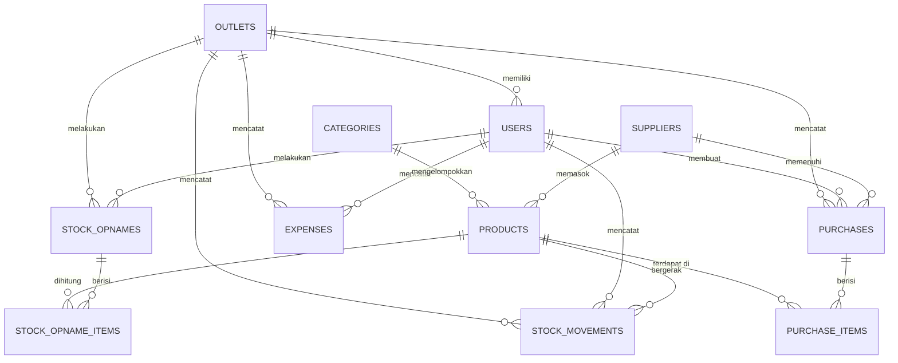
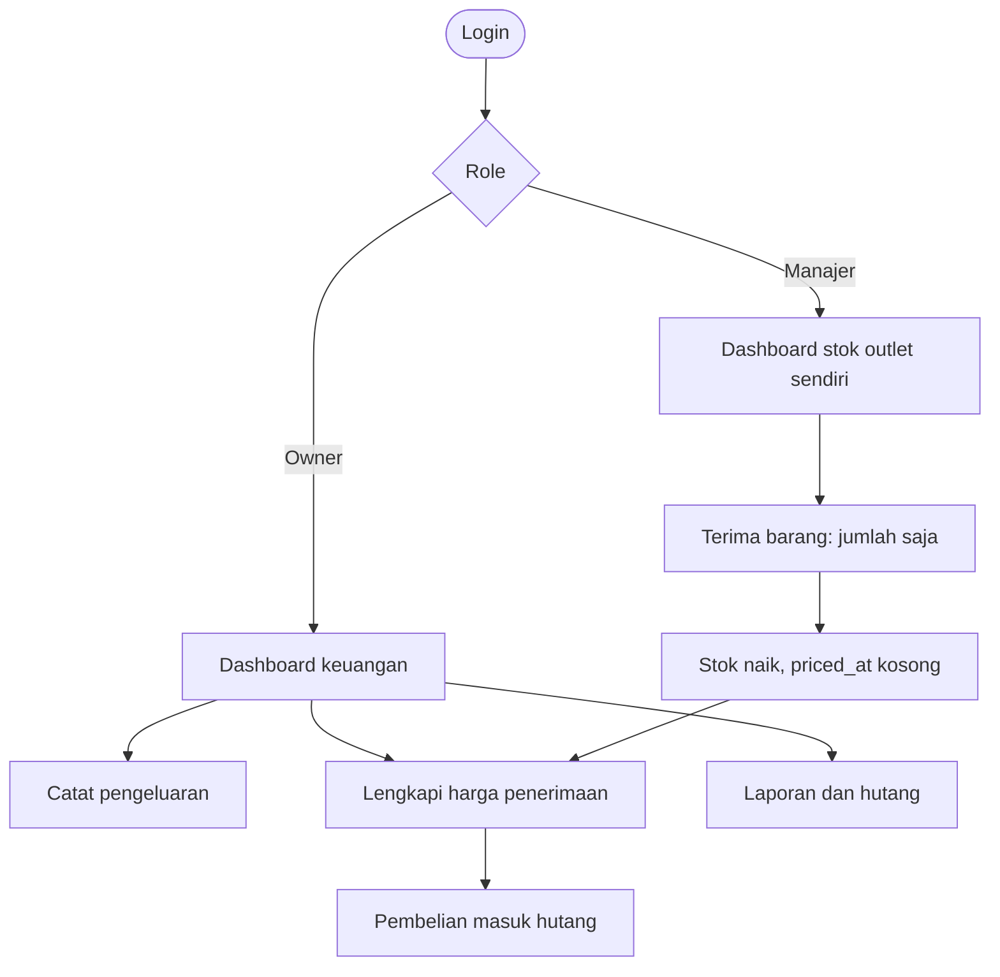
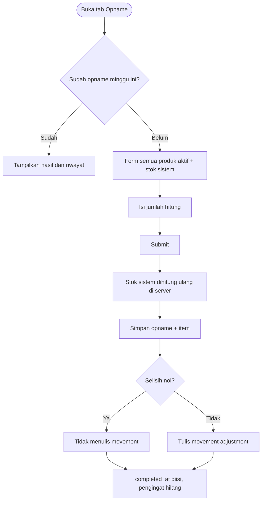

# Materi PDF Presentasi — gudangku

Sumber materi untuk PDF ringkas UAS. Diagram memakai Mermaid; kalau konverter PDF tidak mendukung, render ke PNG lebih dulu.

## 1. Identitas

| Item | Isi |
| :--- | :--- |
| Nama | Chandra TW |
| NIM | 25110300017 |
| Mata kuliah | Web Application Development (WAD04) |
| Institusi | Universitas Cakrawala |
| Judul project | gudangku — aplikasi pencatatan dan stock opname inventaris outlet |
| Live | https://43.173.41.195.sslip.io |
| Repository | https://github.com/ctwiguna/gudangku |
| Tanggal | 28–29 Oktober 2026 |

## 2. Deskripsi

Tagline: **Catat, monitor dan audit stok + Pengeluaran bisnis**.

gudangku mengelola stok barang di beberapa outlet: penerimaan barang dari supplier, harga beli per pcs, hutang supplier, stock opname mingguan, serta pengeluaran operasional per outlet (listrik, air, IPAL, gaji, sewa, lain).

Ada dua role. **Owner** melihat semua outlet, mengatur master data dan user, mengisi harga, melihat laporan. **Manajer outlet** terikat satu outlet, menerima barang dengan jumlah saja, dan wajib opname mingguan. Harga, total pembelian, dan laporan tidak pernah sampai ke manajer — bukan hanya disembunyikan di tampilan, tetapi tidak dikirim di props Inertia.

Arsitektur: React (tampilan) + Inertia.js (jembatan) + Laravel (route, validasi, otorisasi, query, session). Semua logika bisnis di server.

## 3. Stack

| Lapisan | Teknologi | Versi |
| :--- | :--- | :--- |
| Backend | Laravel | 13.39.0 |
| Runtime | PHP | 8.5.12 |
| Frontend | React + Inertia.js + Vite | 19 / 3.5 / 8 |
| Database | MySQL | 8.0.46 (server) |
| Web server | nginx + PHP-FPM | 1.24.0 |
| Styling | CSS variables, komponen sendiri | tanpa UI framework |

## 4. ERD (11 tabel)



Aturan foreign key penting:

| Relasi | Aturan | Alasan |
| :--- | :--- | :--- |
| `products.category_id` | RESTRICT | kategori tidak boleh hilang saat dipakai |
| `products.supplier_id` | SET NULL | produk tetap ada tanpa supplier |
| `purchases.*` | RESTRICT | riwayat pembelian tidak boleh kehilangan relasi |
| `purchase_items.purchase_id` | CASCADE | item ikut pembelian |
| `stock_movement*` | RESTRICT | ledger stok tidak boleh hilang |
| `stock_opname_items.stock_opname_id` | CASCADE | item ikut opname |
| `stock_opnames(outlet_id, week_start)` | UNIQUE | satu opname per outlet per minggu |

**Saldo stok tidak disimpan di kolom.** Saldo adalah `SUM(quantity)` pada `stock_movements` per outlet dan produk. Dengan begitu tidak ada dua sumber kebenaran yang bisa berbeda.

## 5. Flowchart

Alur role dan transaksi:



Alur stock opname:



## 6. Struktur direktori (ringkas)

```text
app/
├── Enums/                 UserRole, MovementType, ExpenseCategory
├── Http/
│   ├── Controllers/       13 controller (auth, dashboard, expense, receipt, purchase,
│   │                      stock opname, product, master data, outlet, user, report,
│   │                      stock movement, profile)
│   ├── Middleware/        EnsureOwner, EnsureManager, HandleInertiaRequests
│   └── Requests/          14 FormRequest
├── Models/                11 model Eloquent
├── Policies/              7 policy
└── Services/              StockService, StockOpnameService, DashboardService
resources/
├── js/
│   ├── Components/        22 komponen design system
│   ├── Layouts/           AppShell, BottomNav, AuthLayout
│   └── Pages/             Auth, Dashboard, Expenses, Products, Receipts, Purchases,
│                          StockOpnames, StockMovements, MasterData, Outlets, Users,
│                          Reports, Settings, Profile, Errors
└── css/app.css            token warna, tipografi, spasi, seluruh state form
routes/web.php             route + middleware role
docs/                      DEPLOY_VPS.md, UJI.md, PRESENTASI.md, SKRIP_VIDEO.md
```

## 7. Lapisan MVC

| Lapisan | Lokasi | Tanggung jawab | Contoh |
| :--- | :--- | :--- | :--- |
| Model | `app/Models` | relasi, scope, agregat | `Product::belowMinStock($outletId)`, `StockMovement::balance()` |
| View | `resources/js/Pages` | render React, state form | `Products/Index.jsx` menyembunyikan kolom harga bila `canManage=false` |
| Controller | `app/Http/Controllers` | terima request, panggil service, siapkan props | `ReceiptController::store()` menulis purchase + item + movement |
| Routing | `routes/web.php` | definisi route dan middleware role | grup `middleware(['auth','owner'])` |
| Validasi | `app/Http/Requests` | aturan input server side | `StoreStockOpnameRequest` mewajibkan semua produk aktif dihitung |
| Otorisasi | `app/Policies`, `app/Http/Middleware` | RBAC dan scoping outlet | `PurchasePolicy::update()` menolak manajer setelah harga diisi |
| Logika bisnis | `app/Services` | transaksi stok dan pembelian | `StockService::record()` satu-satunya pintu tulis ledger |

## 8. Hak akses

| Fitur | Owner | Manajer |
| :--- | :---: | :---: |
| Dashboard | semua outlet | outlet sendiri |
| Harga produk per pcs | lihat & ubah | tidak |
| Pengeluaran & laporan | penuh | 403 |
| Pembelian & pembayaran | penuh | 403 |
| Penerimaan barang | ya | ya, jumlah saja |
| Stock opname | semua outlet | outlet sendiri, wajib mingguan |
| Produk | kelola | lihat, tanpa harga |
| Kategori & supplier | kelola | 403 |
| Outlet & user | kelola | 403 |
| Profil sendiri | ya | ya |

Grup route: `/*` publik (login/register), `auth` (dashboard, produk, penerimaan, opname, riwayat stok, profil), `auth+owner` (pengeluaran, pembelian, master data, outlet, user, laporan, pengaturan).

## 9. Daftar fitur

1. Login, register (manajer nonaktif), logout, rate limit 5/menit.
2. Aktivasi akun dan penugasan outlet oleh owner.
3. Dashboard owner: pengeluaran bulan ini, hutang, antrean harga, nilai stok, produk kritis, status opname.
4. Dashboard manajer: stok outlet, produk kritis, pengingat opname, penerimaan terakhir (tanpa uang).
5. Penerimaan barang tanpa harga + penyesuaian jumlah selama belum berharga.
6. Pelengkapan harga oleh owner, total dihitung ulang di server, masuk hutang.
7. Tandai pembayaran, pembatalan penerimaan belum berharga, stok dikembalikan.
8. Stock opname mingguan: satu per outlet per minggu, penyesuaian otomatis.
9. Riwayat stok (ledger) dengan filter outlet/produk/jenis/periode.
10. CRUD pengeluaran enam kategori (periode wajib untuk gaji).
11. CRUD produk, kategori, supplier, outlet, user.
12. Laporan owner per periode dan outlet.
13. Ekspor Excel pengeluaran per outlet per bulan, empat sheet: Ringkasan (outlet × bulan), Per Kategori (per bulan per kategori + subtotal), Pembelian Produk (per bulan per kategori produk, mis. Gas LPG), dan Rincian.
14. Menu Gudang dengan empat kartu yang seluruhnya bisa diklik: Kelola Outlet, Database Supplier (lead time + term of payment), Harga Barang (satuan pcs/dus/kg, harga satuan, tanggal update harga), dan Kelola Karyawan (gaji + satuan gaji).

## 10. Screenshot (mobile 390px)

Semua file di `docs/screenshots/`, diambil pada viewport 390×844 (2× DPR) memakai Chrome headless dan user agent iPhone.

| File | Isi |
| :--- | :--- |
| `01-login.png` | Form login, state default |
| `15-login-tagline.png` | Tagline aplikasi di layar login |
| `17-warehouse.png` | Menu Gudang: empat kartu yang seluruhnya bisa diklik |
| `20-barang.png` | Harga Barang: Kode Barang, Nama Barang, Satuan, ID Supplier, Harga Satuan, Tanggal Update Harga |
| `21-outlet.png` | Kelola Outlet: kolom ID dan Nama Outlet, tanpa kolom transaksi |
| `22-supplier.png` | Database Supplier: kontak, alamat, lead time, dan term of payment (TOP) |
| `23-karyawan.png` | Kelola Karyawan: nama, gaji, dan satuan gaji (harian/mingguan/bulanan) |
| `18-tambah-kategori.png` | Form tambah kategori terbuka langsung dari menu Gudang |
| `19-tambah-outlet.png` | Form tambah outlet terbuka langsung dari menu Gudang |
| `16-dashboard-tagline.png` | Tagline di header aplikasi (dashboard owner) |
| `02-dashboard-owner.png` | Dashboard owner: 6 kartu angka, status opname, bottom nav |
| `03-expenses.png` | Daftar pengeluaran + filter bulan/outlet |
| `04-expense-form.png` | Form pengeluaran (field periode muncul untuk gaji) |
| `05-products.png` | Produk dengan stok ledger dan kolom harga (owner) |
| `06-purchases.png` | Antrean menunggu harga + daftar pembelian berharga |
| `07-master-data.png` | Kategori & supplier satu halaman bertab |
| `08-stock-opname.png` | Hasil opname minggu ini (owner memilih outlet) |
| `09-stock-movements.png` | Ledger pergerakan stok |
| `10-reports.png` | Laporan pengeluaran per kategori dan outlet |
| `11-profile.png` | Profil sendiri (password lama wajib saat ganti) |
| `12-dashboard-manager.png` | Dashboard manajer: pengingat opname, tanpa uang |
| `13-receipt-form.png` | Form penerimaan barang manajer, tanpa field harga |
| `14-stock-opname-manager.png` | Form hitung opname manajer dengan selisih per baris |

Bukti tambahan yang bisa diambil saat merekam video: halaman 403 (`/reports` sebagai manajer), halaman 404, dan toast sukses setelah menyimpan.

## 11. Langkah deploy (ringkas)

1. VPS Ubuntu 24.04, nginx, PHP 8.5.12 FPM (PPA `ondrej/php`), MySQL 8, Node 22, Composer.
2. `git clone` ke `/var/www/gudangku`, `composer install --no-dev`, `npm ci && npm run build`.
3. `.env` produksi: `APP_ENV=production`, `APP_DEBUG=false`, `APP_TIMEZONE=Asia/Jakarta`, `SESSION_DRIVER=database`, `SESSION_SECURE_COOKIE=true`, kredensial MySQL user non-root.
4. `php artisan key:generate`, `migrate --force`, `config:cache`, `route:cache`, `view:cache`.
5. nginx vhost root ke `public/`, `fastcgi_pass` ke socket PHP 8.5, blok port 80 → 301 HTTPS.
6. Let's Encrypt (`certbot --nginx`), header keamanan termasuk HSTS.
7. Verifikasi: 48 pemeriksaan route × role, logout menghapus sesi, refresh route dalam tetap 200.

Detail lengkap dan 6 masalah nyata saat deploy: `docs/DEPLOY_VPS.md`.

## 12. Ringkasan bukti pengujian

| Bukti | Angka |
| :--- | :--- |
| Test otomatis | 133 test, 609 assertion, semua lulus |
| Matriks route × role di live | 48 pemeriksaan, 0 menyimpang |
| Pemeriksaan mobile (390px & 360px) | 28 halaman, 0 overflow horizontal, bottom nav 57px, target sentuh ≥ 44px |
| `composer audit` | bersih (CVE-2026-45070 dipatch ke symfony/mime 8.1.10) |
| `npm audit` | 0 vulnerability |
| Error log produksi | 0 |
